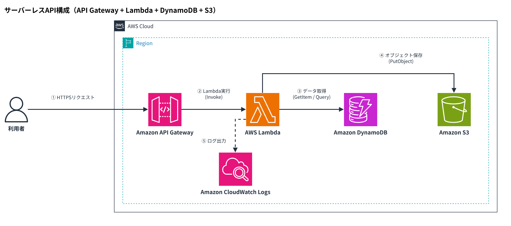

# drawio-practice

Claude Code から指示して draw.io の図を作る練習用リポジトリです。



## ファイル

| ファイル | 内容 |
| --- | --- |
| `aws-serverless.drawio` | AWS構成図（利用者 → API Gateway → Lambda → DynamoDB / S3、ログは CloudWatch Logs） |
| `aws-serverless.drawio.png` | 上の図の PNG（コミット時に自動で作成） |
| `aws-serverless.drawio.url.txt` | 図のデータを埋め込んだ app.diagrams.net 用のURL（コミット時に自動で作成） |
| `.claude/skills/drawio/` | Claude Code 用の作図ルールと手順（skill） |
| `scripts/` | チェック・PNG 変換・URL 作成のスクリプト |
| `.githooks/pre-commit` | コミット時にチェックと PNG・URL の作成を行うフック |

## 図の開き方

- https://app.diagrams.net を開き、`.drawio` をドラッグ＆ドロップする
- `.drawio.url.txt` の URL をブラウザで開く
- デスクトップ版 draw.io や VS Code の Draw.io Integration 拡張で開く

## PNG 確認の仕組み

PNG は draw.io の公式ビューアをヘッドレス Chromium で動かして作ります（外部への通信はしません）。

初回だけ準備します（ビューアを `/opt/drawio-viewer` に置き、日本語フォントを入れます）。

```bash
bash scripts/setup-drawio-viewer.sh
```

コミット時のフックを有効にします。

```bash
git config core.hooksPath .githooks
```

手動で使う場合は次の通りです。

```bash
python3 scripts/drawio-validate.py aws-serverless.drawio
```

```bash
node scripts/drawio-render.js aws-serverless.drawio out.png --scale 2
```

必要なもの: Node.js、Playwright（Chromium 付き）、Python 3。手元の PC に draw.io デスクトップ版が入っていれば、フックは `drawio` CLI でも PNG を作れます。
